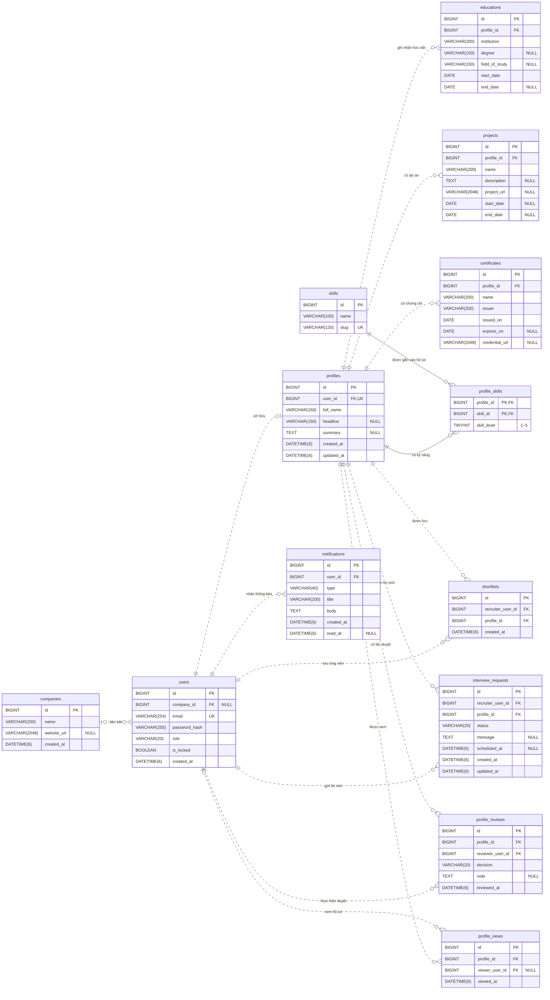

# Thiết kế cơ sở dữ liệu TalentLink — T4E7921

Thiết kế đề xuất cho MySQL 8.4 với InnoDB và `utf8mb4`. Phạm vi gồm tài khoản, hồ sơ ứng viên, hoạt động tuyển dụng, lịch sử duyệt, thông báo và lượt xem. Migration sẽ được viết sau khi mentor duyệt thiết kế.

## Sơ đồ quan hệ

## Bảng, cột chính và ràng buộc

Tất cả PK và FK dùng `BIGINT` có dấu. Các PK `id` dùng `AUTO_INCREMENT`. Mọi cột là `NOT NULL` trừ cột được ghi `NULL` trong sơ đồ. Giá trị `DATETIME(6)` được ghi theo UTC. Các cột mã `role`, `status`, `decision` dùng collation `utf8mb4_0900_as_cs` để `CHECK` phân biệt hoa thường. `PK`, `FK` và `UK` lần lượt là khóa chính, khóa ngoại và ràng buộc duy nhất trên một cột. Khóa duy nhất nhiều cột được ghi rõ bên dưới.

| Bảng | Mục đích và cột chính | PK và FK | Ràng buộc chính |
| --- | --- | --- | --- |
| `users` | Tài khoản đăng nhập. `email`, `password_hash`, `role`, `is_locked`, `created_at` | PK `id`. FK `company_id` → `companies.id`, cho phép `NULL`. | `UNIQUE (email)`. Đề xuất bỏ khoảng trắng đầu/cuối và chuyển email thành chữ thường trước khi lưu và tra cứu. Cột email dùng collation `utf8mb4_0900_as_ci`. Lưu hash mật khẩu có salt theo định dạng của bộ mã hóa. `CHECK (role IN ('CANDIDATE', 'RECRUITER', 'ADMIN'))`. `is_locked` mặc định `FALSE`, `CHECK (is_locked IN (0, 1))`. |
| `profiles` | Hồ sơ ứng viên. `full_name`, `headline`, `summary`, `created_at`, `updated_at` | PK `id`. FK `user_id` → `users.id`. | `UNIQUE (user_id)` và `NOT NULL` bảo đảm mỗi hồ sơ có đúng một chủ sở hữu và mỗi tài khoản có tối đa một hồ sơ. |
| `educations` | Các mục học vấn. `institution`, `degree`, `field_of_study`, `start_date`, `end_date` | PK `id`. FK `profile_id` → `profiles.id`. | `end_date` có thể để trống khi chưa kết thúc. `CHECK (end_date IS NULL OR end_date >= start_date)`. |
| `skills` | Danh mục kỹ năng dùng chung. `name` để hiển thị, `slug` để tra cứu | PK `id`. Không có FK. | `UNIQUE (slug)`. Ứng dụng chuẩn hóa slug trước khi lưu. |
| `profile_skills` | Gắn kỹ năng vào hồ sơ và ghi mức thành thạo `skill_level` | PK ghép `(profile_id, skill_id)`. FK `profile_id` → `profiles.id`. FK `skill_id` → `skills.id`. | PK ghép bảo đảm mỗi cặp hồ sơ–kỹ năng chỉ có một dòng. `skill_level` là `NOT NULL` và có `CHECK (skill_level BETWEEN 1 AND 5)`. |
| `projects` | Các dự án trong hồ sơ. `name`, `description`, `project_url`, `start_date`, `end_date` | PK `id`. FK `profile_id` → `profiles.id`. | Ngày đóng góp có thể để trống. `CHECK (start_date IS NULL OR end_date IS NULL OR end_date >= start_date)`. |
| `certificates` | Các chứng chỉ trong hồ sơ. `name`, `issuer`, `issued_on`, `expires_on`, `credential_url` | PK `id`. FK `profile_id` → `profiles.id`. | `expires_on` có thể để trống. `CHECK (expires_on IS NULL OR expires_on >= issued_on)`. |
| `companies` | Thông tin công ty. `name`, `website_url`, `created_at` | PK `id`. Không có FK. | Nhiều tài khoản có thể trỏ cùng công ty. Cách xác minh và nhận diện công ty chờ mentor chốt. |
| `shortlists` | Danh sách ứng viên đã lưu của từng nhà tuyển dụng. `created_at` ghi thời điểm lưu | PK `id`. FK `recruiter_user_id` → `users.id`. FK `profile_id` → `profiles.id`. | `UNIQUE (recruiter_user_id, profile_id)` chống lưu trùng cho cùng nhà tuyển dụng. |
| `interview_requests` | Lời mời phỏng vấn và trạng thái xử lý. `status`, `message`, `scheduled_at`, `created_at`, `updated_at` | PK `id`. FK `recruiter_user_id` → `users.id`. FK `profile_id` → `profiles.id`. | `CHECK (status IN ('PENDING', 'ACCEPTED', 'DECLINED', 'CANCELLED'))`. Một cặp nhà tuyển dụng–hồ sơ có thể có nhiều lời mời. |
| `profile_reviews` | Nhật ký quyết định duyệt. `decision`, `note`, `reviewed_at` | PK `id`. FK `profile_id` → `profiles.id`. FK `reviewer_user_id` → `users.id`. | `CHECK (decision IN ('APPROVED', 'REJECTED', 'CHANGES_REQUESTED'))`. Mỗi quyết định tạo một dòng mới. Ứng dụng chỉ thêm bản ghi lịch sử. |
| `notifications` | Hộp thông báo của tài khoản. `type`, `title`, `body`, `created_at`, `read_at` | PK `id`. FK `user_id` → `users.id`. | `read_at IS NULL` nghĩa là chưa đọc. |
| `profile_views` | Sự kiện xem hồ sơ. `viewed_at` ghi thời điểm xem | PK `id`. FK `profile_id` → `profiles.id`. FK `viewer_user_id` → `users.id`, cho phép `NULL`. | `viewer_user_id IS NULL` biểu diễn lượt xem ẩn danh. Một người có thể tạo nhiều sự kiện xem. |

## Cách đọc các quan hệ

- **Một–một có tùy chọn.** `users` → `profiles` là `1 → 0..1`. FK `profiles.user_id` vừa `NOT NULL` vừa `UNIQUE`. Tài khoản mới có thể chưa có hồ sơ.
- **Một–nhiều.** Một hồ sơ có thể có nhiều mục học vấn, dự án, chứng chỉ, lần duyệt và lượt xem. Một tài khoản có thể gửi nhiều lời mời, thực hiện nhiều lần duyệt hoặc nhận nhiều thông báo. Với các FK `NOT NULL`, mỗi bản ghi con luôn có đúng một bản ghi cha cho từng FK. Hai FK cho phép `NULL` là `users.company_id` và `profile_views.viewer_user_id`, nên ở mỗi quan hệ này bản ghi con có thể có 0 hoặc 1 bản ghi cha.
- **Nhiều–nhiều.** `profiles` ↔ `skills` đi qua `profile_skills`, gồm hai quan hệ một–nhiều. `shortlists` nối nhà tuyển dụng với các hồ sơ đã lưu theo cùng cấu trúc hai quan hệ một–nhiều. `interview_requests`, `profile_reviews` và `profile_views` ghi các sự kiện giữa tài khoản và hồ sơ, có thể lặp theo cặp.
- **Lịch sử duyệt.** Lấy quyết định gần nhất bằng `ORDER BY reviewed_at DESC, id DESC LIMIT 1`. `id` phân định các bản ghi trùng thời điểm. Hồ sơ chưa có quyết định được xem là chờ duyệt. Đề xuất này suy ra kết quả duyệt từ nhật ký, nên `profiles` không cần cột trạng thái duyệt riêng.
- **Toàn vẹn tham chiếu.** Đề xuất dùng `ON DELETE RESTRICT` và `ON UPDATE RESTRICT` cho các FK để bảo toàn dữ liệu liên kết. Service kiểm tra vai trò khi tạo hồ sơ, liên kết công ty, lưu ứng viên, gửi lời mời hoặc duyệt hồ sơ. FK tới `users.id` kiểm tra tài khoản tồn tại.

## Chỉ mục chính và truy vấn được hỗ trợ

Các câu dưới đây mô tả mẫu `WHERE` và `ORDER BY` của truy vấn. Khai báo chỉ mục theo thứ tự cột trong bảng. Một PK, UNIQUE hoặc chỉ mục ghép có FK ở cột đầu đã hỗ trợ tra cứu theo FK đó.

| Bảng | Chỉ mục đề xuất | Thao tác và mẫu truy vấn |
| --- | --- | --- |
| Các bảng có cột `id` | `PRIMARY KEY (id)` | Lấy hoặc cập nhật một bản ghi theo `WHERE id = ?`. |
| `users` | `UNIQUE (email)` | Tra tài khoản khi đăng nhập hoặc kiểm tra email đã tồn tại bằng `WHERE email = ?`. |
| `users` | `(company_id, role)` | Liệt kê nhà tuyển dụng của công ty bằng `WHERE company_id = ? AND role = 'RECRUITER'`. |
| `profiles` | `UNIQUE (user_id)` | Mở hồ sơ của tài khoản bằng `WHERE user_id = ?`. |
| `educations` | `(profile_id, start_date DESC, id DESC)` | Hiển thị học vấn bằng `WHERE profile_id = ? ORDER BY start_date DESC, id DESC`. |
| `skills` | `UNIQUE (slug)` | Tìm kỹ năng dùng chung bằng `WHERE slug = ?`. |
| `profile_skills` | `PRIMARY KEY (profile_id, skill_id)` | Liệt kê kỹ năng của một hồ sơ bằng `WHERE profile_id = ?` hoặc tìm mức của một kỹ năng bằng `WHERE profile_id = ? AND skill_id = ?`. |
| `profile_skills` | `(skill_id, skill_level, profile_id)` | Tìm hồ sơ đạt ngưỡng thành thạo bằng `WHERE skill_id = ? AND skill_level >= ?`. |
| `projects` | `(profile_id, start_date DESC, id DESC)` | Hiển thị dự án bằng `WHERE profile_id = ? ORDER BY start_date DESC, id DESC`. |
| `certificates` | `(profile_id, issued_on DESC, id DESC)` | Hiển thị chứng chỉ mới cấp trước bằng `WHERE profile_id = ? ORDER BY issued_on DESC, id DESC`. |
| `shortlists` | `UNIQUE (recruiter_user_id, profile_id)` | Kiểm tra đã lưu ứng viên bằng `WHERE recruiter_user_id = ? AND profile_id = ?`. |
| `shortlists` | `(recruiter_user_id, created_at DESC, id DESC)` | Mở danh sách đã lưu bằng `WHERE recruiter_user_id = ? ORDER BY created_at DESC, id DESC`. |
| `shortlists` | `(profile_id)` | Đếm số nhà tuyển dụng đã lưu một hồ sơ bằng `WHERE profile_id = ?`. |
| `interview_requests` | `(profile_id, status, created_at DESC, id DESC)` | Mở lời mời chờ phản hồi bằng `WHERE profile_id = ? AND status = 'PENDING' ORDER BY created_at DESC, id DESC`. |
| `interview_requests` | `(recruiter_user_id, created_at DESC, id DESC)` | Xem lời mời đã gửi bằng `WHERE recruiter_user_id = ? ORDER BY created_at DESC, id DESC`. |
| `profile_reviews` | `(profile_id, reviewed_at DESC, id DESC)` | Xem lịch sử duyệt bằng `WHERE profile_id = ? ORDER BY reviewed_at DESC, id DESC`. Thêm `LIMIT 1` để lấy quyết định gần nhất. |
| `profile_reviews` | `(reviewer_user_id, reviewed_at DESC, id DESC)` | Xem các quyết định của một người duyệt bằng `WHERE reviewer_user_id = ? ORDER BY reviewed_at DESC, id DESC`. |
| `notifications` | `(user_id, created_at DESC, id DESC)` | Mở hộp thông báo bằng `WHERE user_id = ? ORDER BY created_at DESC, id DESC`. |
| `notifications` | `(user_id, read_at, created_at DESC, id DESC)` | Mở thông báo chưa đọc bằng `WHERE user_id = ? AND read_at IS NULL ORDER BY created_at DESC, id DESC`. |
| `profile_views` | `(profile_id, viewed_at)` | Đếm lượt xem theo kỳ bằng `WHERE profile_id = ? AND viewed_at >= ? AND viewed_at < ?`. |
| `profile_views` | `(viewer_user_id)` | Tra các sự kiện gắn với một tài khoản khi xử lý yêu cầu về dữ liệu cá nhân bằng `WHERE viewer_user_id = ?`. |

## Giả định nghiệp vụ cần mentor xác nhận

1. **Tài khoản và công ty.** Mỗi tài khoản có một vai trò. Chỉ ứng viên có hồ sơ. Một nhà tuyển dụng thuộc tối đa một công ty và có thể để trống trong lúc chờ liên kết. Cần chốt ai xác minh liên kết, khi nào công ty là bắt buộc, và có cần hỗ trợ một người thuộc nhiều công ty hoặc nhiều vai trò hay không.
2. **Quyền sở hữu hoạt động tuyển dụng.** Danh sách lưu và lời mời phỏng vấn thuộc từng tài khoản nhà tuyển dụng. Cần chốt có chia sẻ theo công ty không, có cho nhiều lời mời đang chờ trên cùng một hồ sơ không và lúc nào phải có `scheduled_at`.
3. **Luồng duyệt và công bố.** Đề xuất vai trò `ADMIN` duyệt, ghi một dòng mỗi quyết định. Cần chốt cách gửi duyệt lại sau chỉnh sửa, có lưu phiên bản hồ sơ đã duyệt không, và phiên bản nào được hiển thị khi đang chờ duyệt lại.
4. **Lượt xem và quyền riêng tư.** Đề xuất đếm theo sự kiện, có khách ẩn danh. Cần chốt cách tính lượt xem duy nhất, có loại lượt tự xem không, thời hạn lưu và quy tắc ẩn danh khi tài khoản bị xóa.
5. **Vòng đời dữ liệu.** Cần chốt chuẩn email và khả năng tái sử dụng email, việc vô hiệu hóa hay xóa tài khoản, cùng cách lưu giữ hoặc ẩn danh lịch sử duyệt và tuyển dụng. Thiết kế hiện đề xuất `RESTRICT` trong khi chờ quyết định này.

Tham chiếu kỹ thuật cho ràng buộc và sơ đồ. [Khóa ngoại MySQL](https://dev.mysql.com/doc/refman/8.4/en/create-table-foreign-keys.html), [CHECK MySQL](https://dev.mysql.com/doc/refman/8.4/en/create-table-check-constraints.html), [Cú pháp ERD Mermaid](https://mermaid.js.org/syntax/entityRelationshipDiagram.html).
